# API do Instituto Mão Amiga

API REST em Spring Boot que gerencia os **pontos de coleta e distribuição** do Instituto Mão Amiga.
Ela fica nesta pasta (`api/`), dentro do repositório do aplicativo.

## Tecnologias

- Java **21**
- Spring Boot 4.1.1 (Spring Web, Spring Data JPA, Bean Validation)
- Banco **H2 gravando em arquivo** (`api/data/maoamiga`), que continua depois de reiniciar a API
- Lombok
- Swagger (springdoc-openapi 3.1.0)

## Como executar

Na pasta `api/`:

```powershell
.\mvnw spring-boot:run
```

Ou, no IntelliJ IDEA, abra a pasta `api/` como projeto Maven e execute a classe `MaoAmigaApiApplication`.

A API sobe em `http://localhost:8080`. A carga inicial cria **25 pontos de Goiânia** (dados de demonstração) na primeira execução e **não duplica** nas seguintes.
Se o IntelliJ marcar erros no Lombok, ative *Settings > Build > Compiler > Annotation Processors > Enable annotation processing*.

Swagger (documentação e testes dos endpoints): <http://localhost:8080/swagger-ui/index.html>

## Pontos

Campos de um ponto:

| Campo | Tipo | Observação |
|---|---|---|
| `id` | UUID | gerado pela API |
| `nome` | texto | obrigatório, até 100 caracteres |
| `endereco` | texto | obrigatório, até 200 caracteres |
| `bairro` | texto | obrigatório, até 100 caracteres |
| `horario` | texto | obrigatório, até 100 caracteres (ex.: "Seg a Sex, 8h às 17h") |
| `tipo` | texto | obrigatório: `coleta` ou `distribuição` |

### Endpoints

| Método | URL | O que faz | Respostas |
|---|---|---|---|
| GET | `http://localhost:8080/api/v1/pontos` | Lista todos os pontos | 200 |
| GET | `http://localhost:8080/api/v1/pontos/filtro?filtro=...&page=0&size=10` | Busca por nome ou bairro, com paginação | 200, 400 |
| GET | `http://localhost:8080/api/v1/pontos/{id}` | Busca um ponto pelo id | 200, 404 |
| POST | `http://localhost:8080/api/v1/pontos` | Cadastra um ponto | 201, 400 |
| PUT | `http://localhost:8080/api/v1/pontos/{id}` | Edita um ponto | 200, 400, 404 |
| DELETE | `http://localhost:8080/api/v1/pontos/{id}` | Exclui um ponto | 204, 404 |

Corpo de exemplo para `POST` e `PUT`:

```json
{
  "nome": "Ponto de Coleta Setor Oeste",
  "endereco": "Rua 5, nº 100, Setor Oeste, Goiânia-GO",
  "bairro": "Setor Oeste",
  "horario": "Segunda a sexta, das 8h às 17h",
  "tipo": "coleta"
}
```

### Erros

Todas as respostas de erro têm o mesmo formato:

- **400** — campo obrigatório vazio ou inválido (nada é gravado). Traz a mensagem de cada campo em `campos`.
  ```json
  { "status": 400, "mensagem": "Verifique os campos informados.", "campos": { "nome": "O nome é obrigatório." } }
  ```
- **404** — id inexistente em `GET`, `PUT` ou `DELETE`.
  ```json
  { "status": 404, "mensagem": "Ponto não encontrado." }
  ```

### Prints do Swagger

Cada resposta testada em `http://localhost:8080/swagger-ui/index.html`.

| Endpoint | Resposta | Print |
|---|---|---|
| `GET /api/v1/pontos` | 200 | 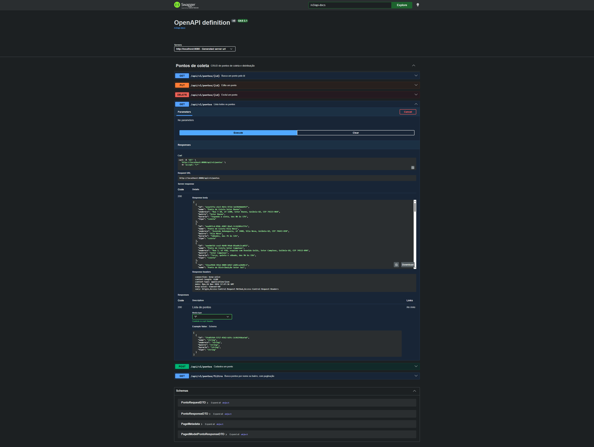 |
| `GET /api/v1/pontos/{id}` | 200 | 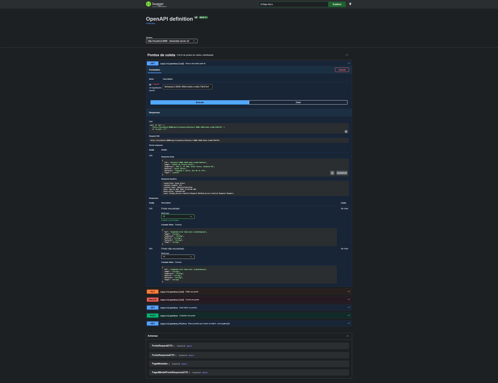 |
| `POST /api/v1/pontos` | 201 | 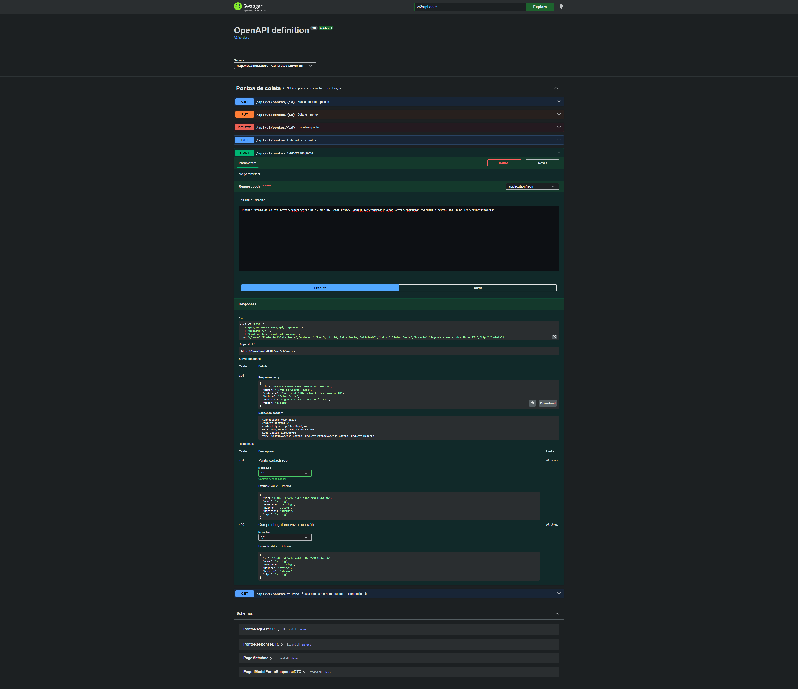 |
| `PUT /api/v1/pontos/{id}` | 200 | 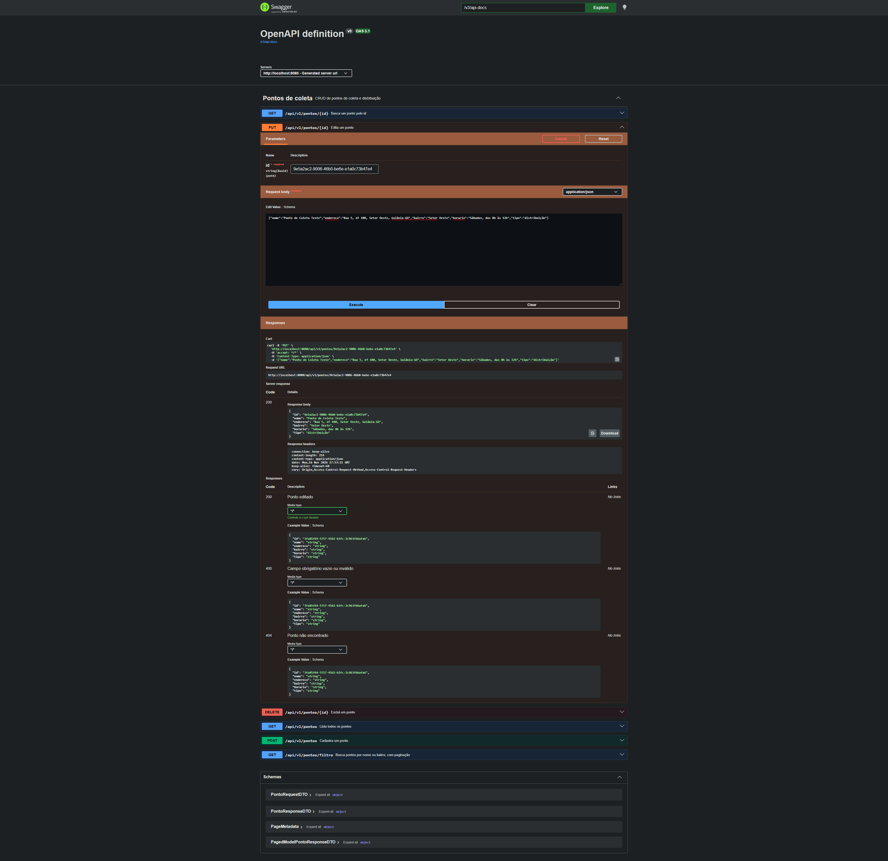 |
| `DELETE /api/v1/pontos/{id}` | 204 | 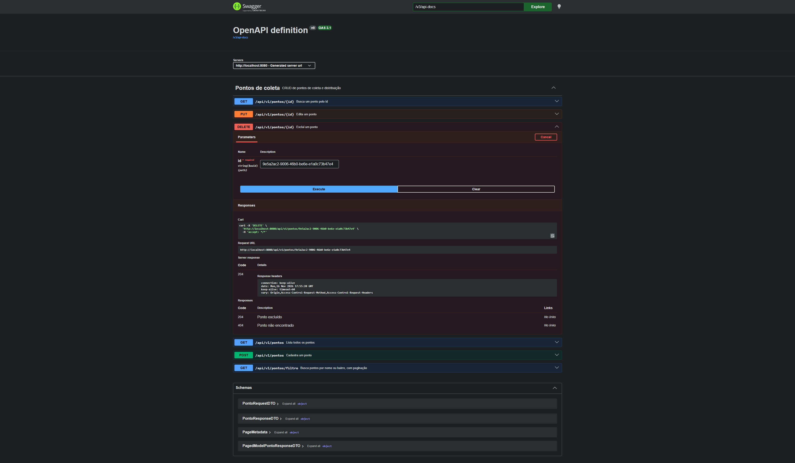 |
| `POST /api/v1/pontos` com campos vazios | **400** |  |
| `DELETE /api/v1/pontos/{id}` com id inexistente | **404** | 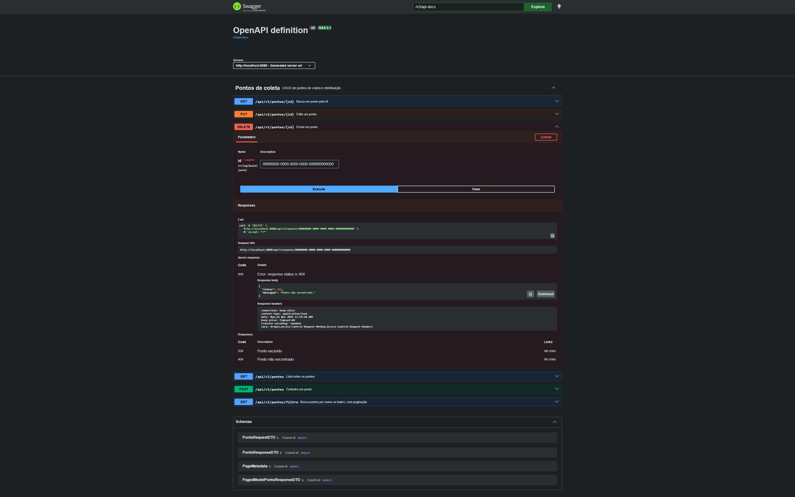 |
| `GET /api/v1/pontos/filtro?filtro=bueno` | 200 | 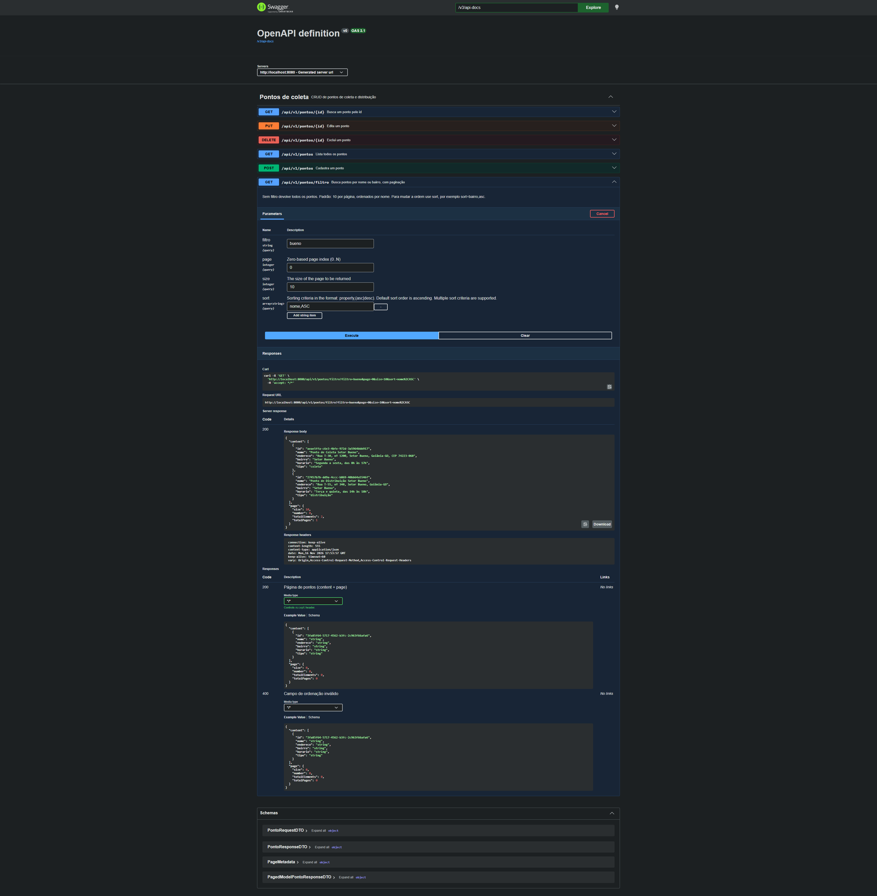 |

## Busca com paginação

`GET /api/v1/pontos/filtro` devolve uma página de pontos.

| Parâmetro | Padrão | O que faz |
|---|---|---|
| `filtro` | vazio | Procura no **nome** ou no **bairro**, sem diferenciar maiúsculas de minúsculas. Vazio devolve todos os pontos. |
| `page` | `0` | Número da página (começa em 0). |
| `size` | `10` | Itens por página. |
| `sort` | `nome` | Ordenação, por exemplo `sort=bairro,asc` ou `sort=nome,desc`. Campo inexistente responde 400. |

A resposta tem o formato `content` (a lista da página) + `page` (`size`, `number`, `totalElements` e `totalPages`).

### Chamadas e respostas reais

Respostas obtidas com a API rodando e a carga inicial de 25 pontos.

**1. Sem filtro (duas por página)**

`GET http://localhost:8080/api/v1/pontos/filtro?size=2` → **200**

```json
{
  "content": [
    {
      "id": "bd0b5578-98f8-411e-9f9a-73842de3c120",
      "nome": "Ponto de Coleta Cidade Jardim",
      "endereco": "Rua CJ-3, nº 77, Cidade Jardim, Goiânia-GO",
      "bairro": "Cidade Jardim",
      "horario": "Sábados e domingos, das 8h às 12h",
      "tipo": "coleta"
    },
    {
      "id": "78e02098-c0c1-489a-9bb0-d178d2c35165",
      "nome": "Ponto de Coleta Jardim América",
      "endereco": "Rua 90, nº 320, Jardim América, Goiânia-GO, CEP 74275-110",
      "bairro": "Jardim América",
      "horario": "Terça e quinta, das 8h às 12h",
      "tipo": "coleta"
    }
  ],
  "page": {
    "size": 2,
    "number": 0,
    "totalElements": 25,
    "totalPages": 13
  }
}
```

**2. Filtrando por bairro**

`GET http://localhost:8080/api/v1/pontos/filtro?filtro=bueno` → **200**

```json
{
  "content": [
    {
      "id": "aeae5ffa-c6e3-4bfe-972d-3a5964bbb917",
      "nome": "Ponto de Coleta Setor Bueno",
      "endereco": "Rua T-30, nº 1200, Setor Bueno, Goiânia-GO, CEP 74223-060",
      "bairro": "Setor Bueno",
      "horario": "Segunda a sexta, das 8h às 17h",
      "tipo": "coleta"
    },
    {
      "id": "27457b7b-dd9a-4ccc-b869-40bb64a5546f",
      "nome": "Ponto de Distribuição Setor Bueno",
      "endereco": "Rua T-55, nº 340, Setor Bueno, Goiânia-GO",
      "bairro": "Setor Bueno",
      "horario": "Terça e quinta, das 14h às 18h",
      "tipo": "distribuição"
    }
  ],
  "page": {
    "size": 10,
    "number": 0,
    "totalElements": 2,
    "totalPages": 1
  }
}
```

**3. Segunda página**

`GET http://localhost:8080/api/v1/pontos/filtro?page=1&size=10` → **200**

```json
{
  "content": [
    {
      "id": "f544c626-5546-4a16-bbab-2ed76f044082",
      "nome": "Ponto de Coleta Setor Marista",
      "endereco": "Rua 9, nº 1330, Setor Marista, Goiânia-GO, CEP 74150-030",
      "bairro": "Setor Marista",
      "horario": "Sábados e domingos, das 8h às 13h",
      "tipo": "coleta"
    },
    {
      "id": "f876b2d4-f55c-4ee0-abb8-582b946dd0d3",
      "nome": "Ponto de Coleta Setor Negrão de Lima",
      "endereco": "Rua NL-2, nº 60, Setor Negrão de Lima, Goiânia-GO",
      "bairro": "Setor Negrão de Lima",
      "horario": "Segunda a sexta, das 8h às 14h",
      "tipo": "coleta"
    },
    {
      "id": "c6f4262a-a0e5-4181-acc7-d283e1ae4141",
      "nome": "Ponto de Coleta Setor Oeste",
      "endereco": "Rua 5, nº 410, Setor Oeste, Goiânia-GO",
      "bairro": "Setor Oeste",
      "horario": "Segunda a sexta, das 9h às 17h",
      "tipo": "coleta"
    },
    {
      "id": "ded118a7-7a36-46ba-9bf2-5b74a111e1e9",
      "nome": "Ponto de Coleta Setor Universitário",
      "endereco": "Avenida Universitária, nº 1500, Setor Universitário, Goiânia-GO",
      "bairro": "Setor Universitário",
      "horario": "Segunda a sexta, das 10h às 16h",
      "tipo": "coleta"
    },
    {
      "id": "5eb9ba19-5b00-4562-8a98-2f12d346432b",
      "nome": "Ponto de Coleta Setor dos Funcionários",
      "endereco": "Rua 32, nº 210, Setor dos Funcionários, Goiânia-GO",
      "bairro": "Setor dos Funcionários",
      "horario": "Segunda a sexta, das 9h às 15h",
      "tipo": "coleta"
    },
    {
      "id": "aee0ffcd-858c-4987-96a5-fc1620fef7fe",
      "nome": "Ponto de Coleta Vila Nova",
      "endereco": "Avenida Anhanguera, nº 3400, Vila Nova, Goiânia-GO, CEP 74643-030",
      "bairro": "Vila Nova",
      "horario": "Sábados, das 7h às 12h",
      "tipo": "coleta"
    },
    {
      "id": "0f066b5f-f458-49fa-b3cb-8cdba4b4adc8",
      "nome": "Ponto de Coleta Vila Rosa",
      "endereco": "Rua 12, nº 45, Vila Rosa, Goiânia-GO",
      "bairro": "Vila Rosa",
      "horario": "Segunda, quarta e sexta, das 8h às 11h",
      "tipo": "coleta"
    },
    {
      "id": "4070cf4e-3e07-4785-849b-40997d60a5c9",
      "nome": "Ponto de Distribuição Jardim Goiás",
      "endereco": "Rua 17, nº 250, Jardim Goiás, Goiânia-GO",
      "bairro": "Jardim Goiás",
      "horario": "Sábados, das 8h às 12h",
      "tipo": "distribuição"
    },
    {
      "id": "d903cec2-1856-46e2-808e-b48439119186",
      "nome": "Ponto de Distribuição Jardim Novo Mundo",
      "endereco": "Rua JN-4, nº 120, Jardim Novo Mundo, Goiânia-GO",
      "bairro": "Jardim Novo Mundo",
      "horario": "Domingos, das 8h às 12h",
      "tipo": "distribuição"
    },
    {
      "id": "2c170634-16ec-4d01-a493-b01895bad563",
      "nome": "Ponto de Distribuição Residencial Eldorado",
      "endereco": "Rua RE-10, nº 150, Residencial Eldorado, Goiânia-GO",
      "bairro": "Residencial Eldorado",
      "horario": "Quartas, das 14h às 18h",
      "tipo": "distribuição"
    }
  ],
  "page": {
    "size": 10,
    "number": 1,
    "totalElements": 25,
    "totalPages": 3
  }
}
```

**4. Ordenando por bairro**

`GET http://localhost:8080/api/v1/pontos/filtro?sort=bairro,asc&size=3` → **200**

```json
{
  "content": [
    {
      "id": "bd0b5578-98f8-411e-9f9a-73842de3c120",
      "nome": "Ponto de Coleta Cidade Jardim",
      "endereco": "Rua CJ-3, nº 77, Cidade Jardim, Goiânia-GO",
      "bairro": "Cidade Jardim",
      "horario": "Sábados e domingos, das 8h às 12h",
      "tipo": "coleta"
    },
    {
      "id": "78e02098-c0c1-489a-9bb0-d178d2c35165",
      "nome": "Ponto de Coleta Jardim América",
      "endereco": "Rua 90, nº 320, Jardim América, Goiânia-GO, CEP 74275-110",
      "bairro": "Jardim América",
      "horario": "Terça e quinta, das 8h às 12h",
      "tipo": "coleta"
    },
    {
      "id": "4070cf4e-3e07-4785-849b-40997d60a5c9",
      "nome": "Ponto de Distribuição Jardim Goiás",
      "endereco": "Rua 17, nº 250, Jardim Goiás, Goiânia-GO",
      "bairro": "Jardim Goiás",
      "horario": "Sábados, das 8h às 12h",
      "tipo": "distribuição"
    }
  ],
  "page": {
    "size": 3,
    "number": 0,
    "totalElements": 25,
    "totalPages": 9
  }
}
```

**Campo de ordenação inexistente**

`GET http://localhost:8080/api/v1/pontos/filtro?sort=campoInexistente` → **400**

```json
{ "status": 400, "mensagem": "Campo de ordenação inválido." }
```

## Doações

Campos de uma doação:

| Campo | Tipo | Observação |
|---|---|---|
| `id` | UUID | gerado pela API |
| `tipoItem` | texto | obrigatório, até 100 caracteres (ex.: "roupas") |
| `quantidade` | inteiro | obrigatório, maior que zero |
| `pontoDestino` | texto | obrigatório, até 100 caracteres (nome do ponto) |
| `criadoEm` | data e hora | gerada pela API no cadastro; **não muda na edição** e é ignorada se vier no corpo |

### Endpoints

| Método | URL | O que faz | Respostas |
|---|---|---|---|
| GET | `http://localhost:8080/api/v1/doacoes/filtro?filtro=...&page=0&size=10` | Busca por tipo do item, com paginação | 200, 400 |
| GET | `http://localhost:8080/api/v1/doacoes/{id}` | Busca uma doação pelo id | 200, 404 |
| POST | `http://localhost:8080/api/v1/doacoes` | Cadastra uma doação | 201, 400 |
| PUT | `http://localhost:8080/api/v1/doacoes/{id}` | Edita uma doação (mantém `id` e `criadoEm`) | 200, 400, 404 |
| DELETE | `http://localhost:8080/api/v1/doacoes/{id}` | Exclui uma doação | 204, 404 |

No `/filtro`, `filtro` procura no **tipo do item** (sem diferenciar maiúsculas de minúsculas; vazio devolve todas). Padrão: `page=0`, `size=10`, `sort=criadoEm,DESC` (da mais nova para a mais antiga). A resposta tem o mesmo formato `content` + `page` dos pontos. Campo de ordenação inexistente responde 400.

Corpo de exemplo para `POST` e `PUT`:

```json
{
  "tipoItem": "roupas",
  "quantidade": 3,
  "pontoDestino": "Ponto de Coleta Setor Bueno"
}
```

Resposta do `POST` (**201**):

```json
{
  "id": "033a5e60-1bcc-4952-b08f-5016cb985809",
  "tipoItem": "roupas",
  "quantidade": 3,
  "pontoDestino": "Ponto de Coleta Setor Bueno",
  "criadoEm": "2026-11-16T16:26:29.787669"
}
```

### Erros

Mesmo formato dos pontos:

- **400**: campo obrigatório vazio, quantidade zero ou negativa, ou `sort` inválido (nada é gravado).
  ```json
  { "status": 400, "mensagem": "Verifique os campos informados.", "campos": { "quantidade": "A quantidade deve ser maior que zero." } }
  ```
- **404**: id inexistente em `GET`, `PUT` ou `DELETE`.
  ```json
  { "status": 404, "mensagem": "Doação não encontrada." }
  ```

### Prints do Swagger (doações)

| Endpoint | Resposta | Print |
|---|---|---|
| `GET /api/v1/doacoes/filtro?filtro=roupas` | 200 | 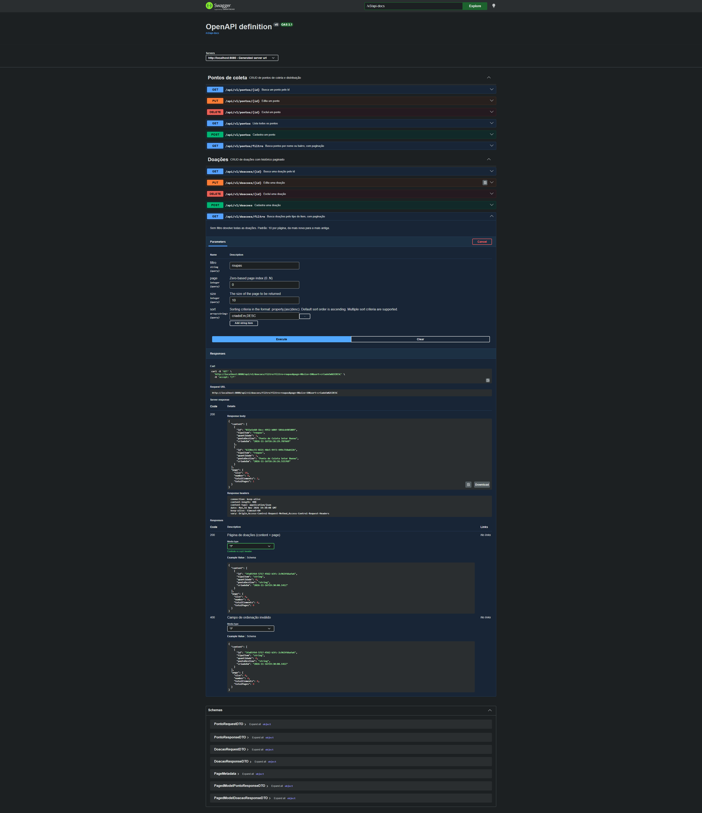 |
| `GET /api/v1/doacoes/{id}` | 200 | 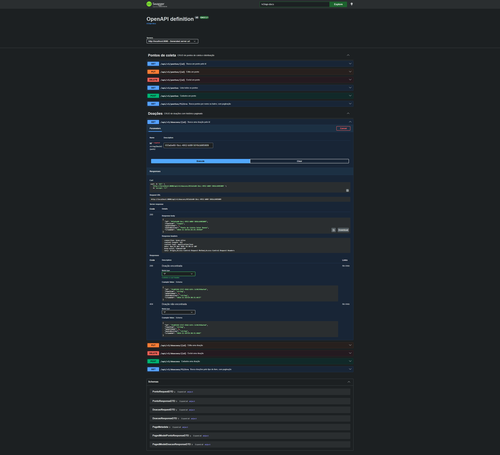 |
| `POST /api/v1/doacoes` | 201 | 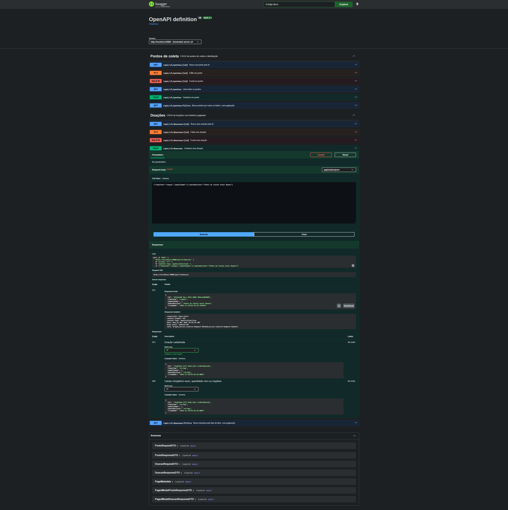 |
| `PUT /api/v1/doacoes/{id}` | 200 | 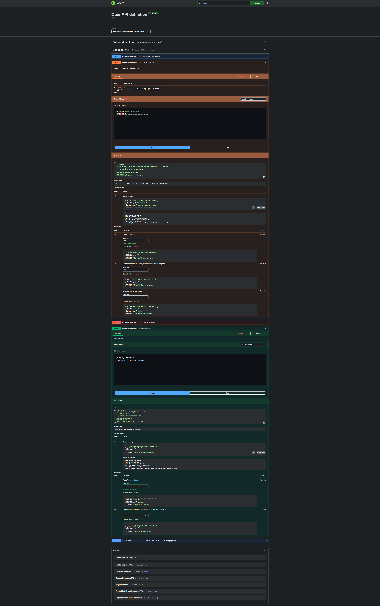 |
| `DELETE /api/v1/doacoes/{id}` | 204 | 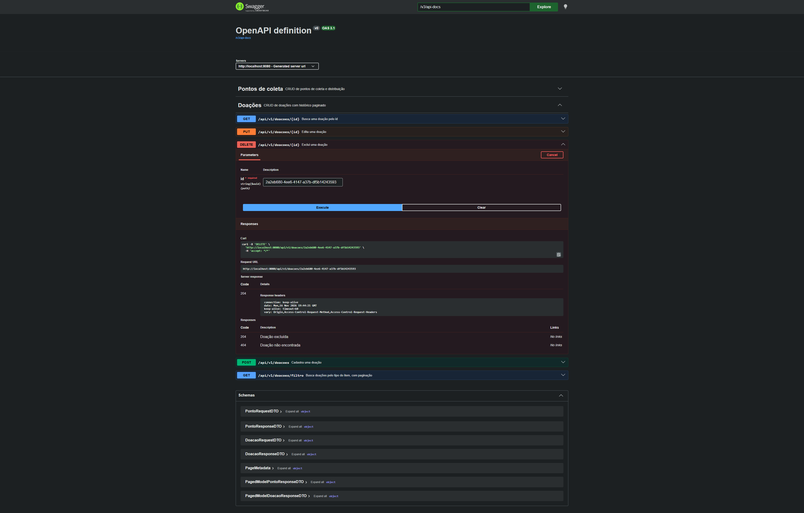 |
| `POST /api/v1/doacoes` com quantidade 0 | **400** | 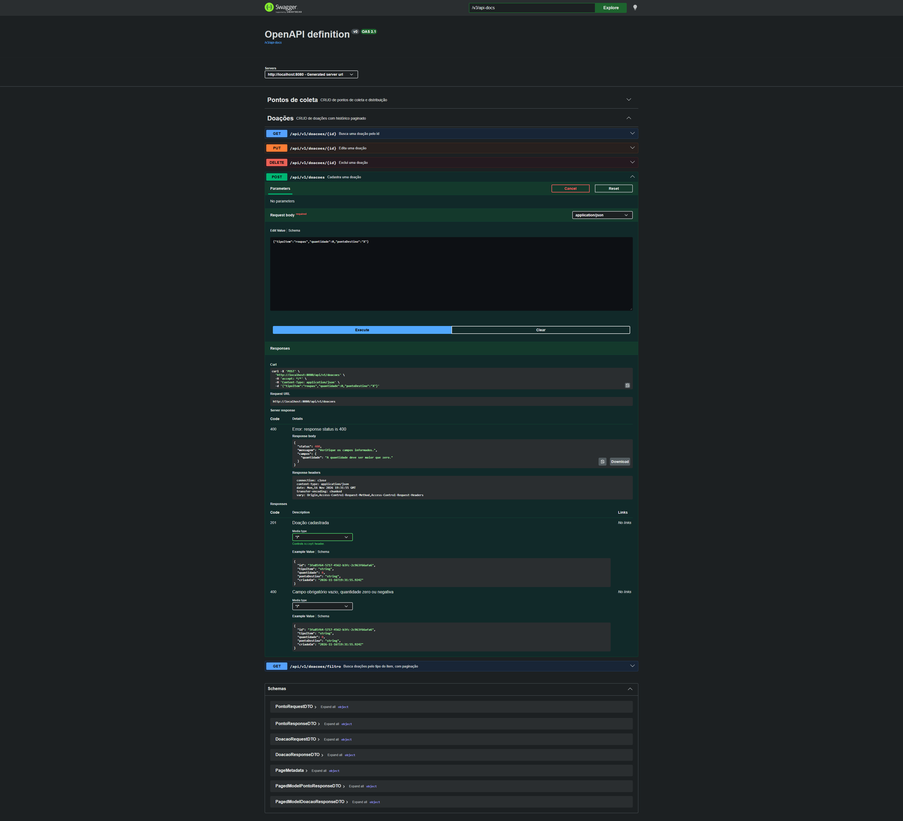 |
| `GET /api/v1/doacoes/{id}` com id inexistente | **404** | 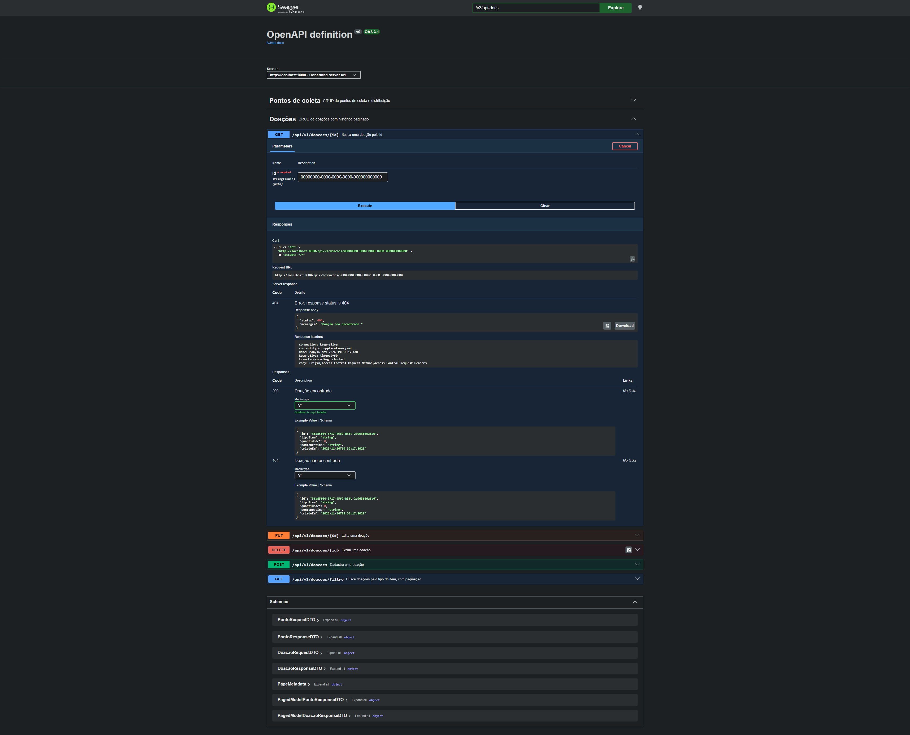 |
